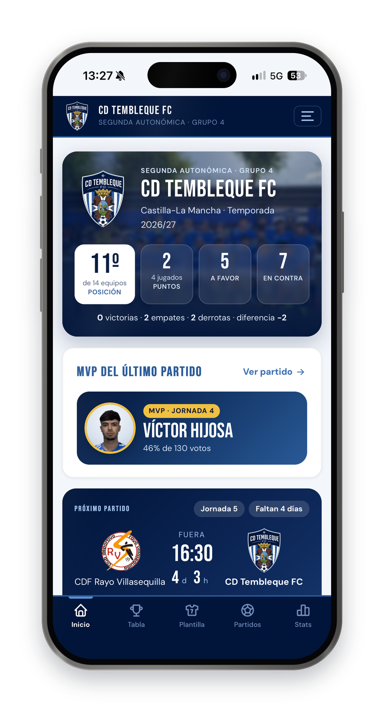
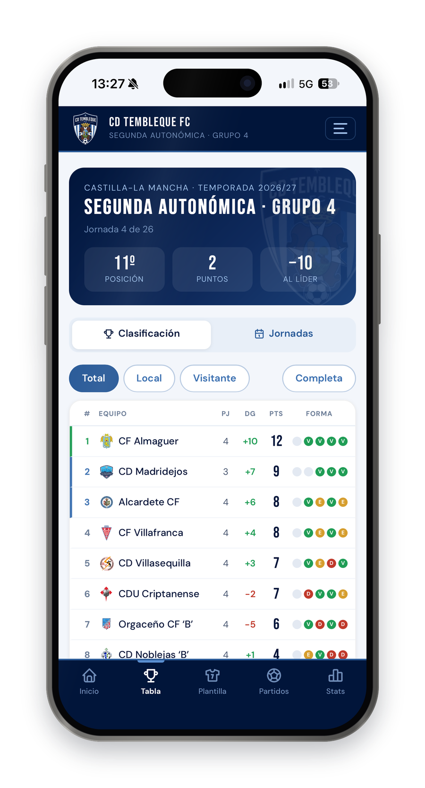
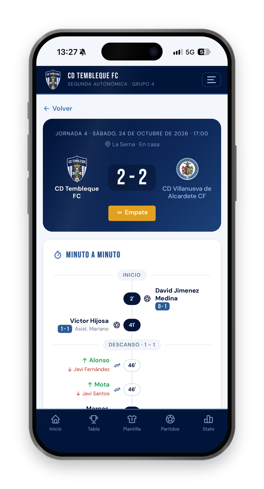
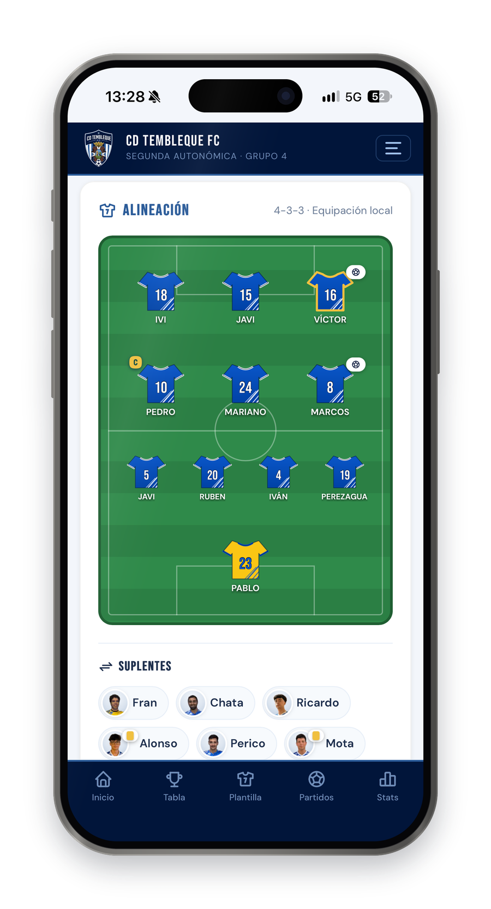
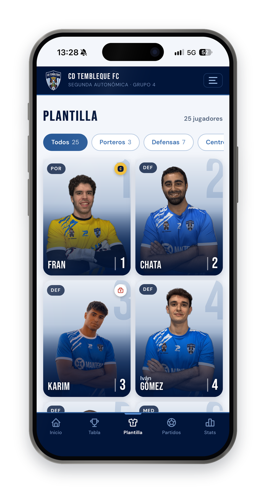
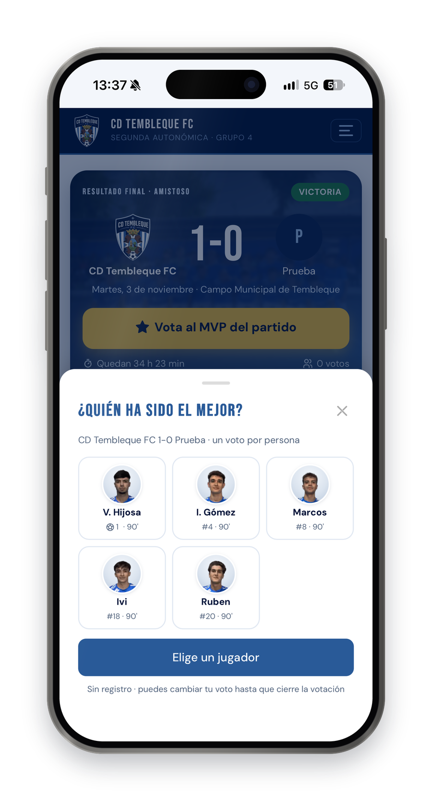
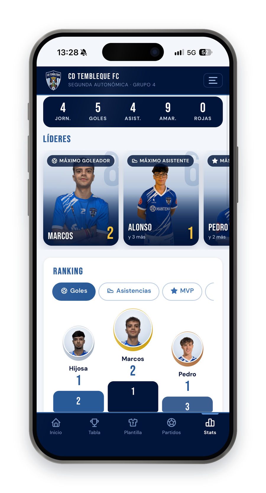
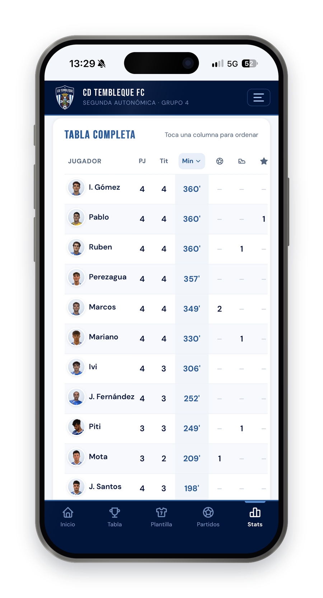
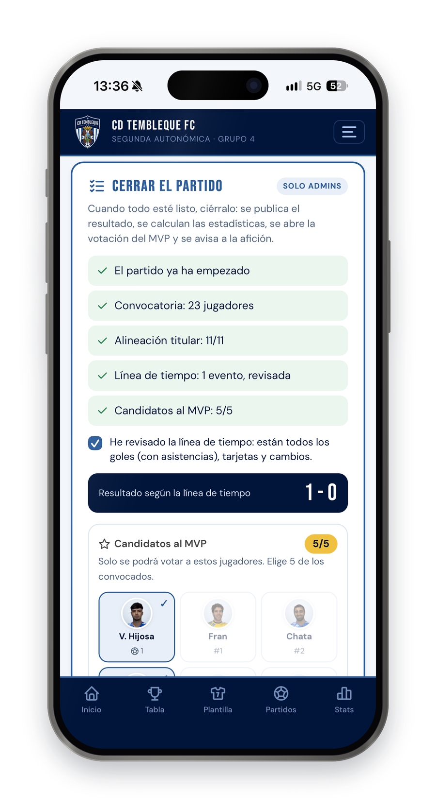
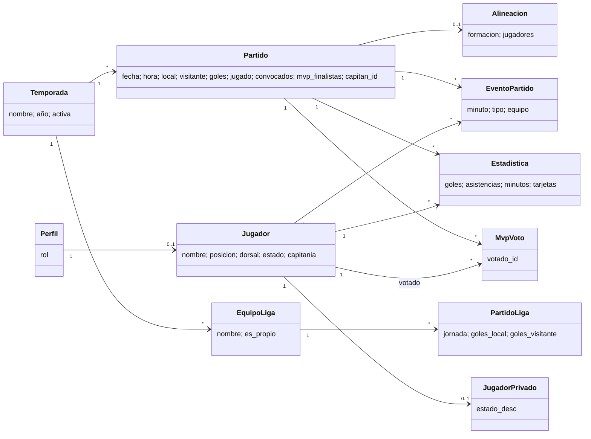

# ⚽ CD Tembleque FC — Club Progressive Web App (React + Supabase)

The official app of **CD Tembleque FC**, a football club in **Segunda Autonómica de Castilla-La Mancha (Group 4)**. Fans follow results, the league table, the squad and the season stats, watch a minute-by-minute timeline of every match and **vote for the man of the match**. The club staff run everything from an admin panel. It installs on any phone like a native app.

> 🏟️ **Real-world project, built with AI.** I designed this app for my local club and run it in production, used by its players, staff and fans: **[cd-tembleque-fc.vercel.app](https://cd-tembleque-fc.vercel.app)**
> Most of the code was written with **[Claude](https://claude.ai)** (Anthropic) as a pair programmer. See [How it was built](#-how-it-was-built) for what was done by me and what by the AI.

---

## 📸 Screenshots

| Home | League table | Match timeline |
|---|---|---|
|  |  |  |

| Line-up | Squad | MVP voting |
|---|---|---|
|  |  |  |

| Season stats | Full stats table | Closing a match (admin) |
|---|---|---|
|  |  |  |

---

## ✨ Features

- **Home**: league position, points and goals, the last MVP and a countdown to the next match.
- **League table** computed automatically from every result of the group:
  - total, home and away tables, plus the form guide (last 5);
  - promotion, play-off and relegation zones, points deductions and head-to-head tie-breaks;
  - a **matchday** view with every fixture of each round.
- **Match detail**:
  - minute-by-minute **timeline**: goals (penalty, own goal), assists, yellow, second-yellow and red cards, and substitutions;
  - **11-a-side line-up** on a pitch (4-4-2, 4-3-3, 4-2-3-1…) with the club kits, the goalkeeper kit and the captain's armband;
  - call-up and substitutes.
- **MVP fan vote**. Anyone can vote without signing up:
  - the vote opens when the match is closed and ends at 23:59 (Madrid time) the next day;
  - one vote per device, which can be changed until the vote closes;
  - the candidates are 5 players chosen by the club;
  - admins can export the winner as an Instagram-ready image (1080×1350).
- **Season stats**:
  - goals, assists, **minutes played**, appearances, starts, cards, saves, goals conceded and MVPs;
  - leader cards, a podium and a sortable table.
- **Player profiles**: position, number, captaincy, availability (injured, doubtful, suspended…) and a match-by-match log, including the matches he wasn't called up for.
- **"Close the match" flow**. The result, the stats, the MVP vote and the push notification go out together. This only happens once the line-up, the timeline and the MVP candidates are ready, so fans never see half-finished data.
- **Push notifications** with the final result and a link to vote.
- **Admin panel**: matches, stats, squad, league (teams, results, zones), seasons, sponsors and an activity log.
- **Installable PWA** with offline caching, haptic feedback and pull-to-refresh.

---

## 🧰 Tech Stack

| Layer | Technology |
|---|---|
| Frontend | **React 18** + **React Router 6**, built with **Vite 5** |
| Backend | **Supabase**: PostgreSQL, Auth, Row Level Security, Edge Functions, `pg_cron` |
| Database logic | SQL migrations, validation triggers, `SECURITY DEFINER` functions |
| Images | **Cloudinary** (unsigned uploads), in-app cropper |
| Notifications | Web Push (VAPID) through the `send-push` Edge Function |
| Hosting | **Vercel** (production on `main`, preview per pull request) + Vercel Web Analytics |
| Icons | Tabler Icons, vendored as SVG path data (no icon dependency) |
| Testing | **Vitest** (unit tests) + **pgTAP** (database and RLS tests) |
| CI | GitHub Actions: tests and build on every push and pull request; Supabase keep-alive |

---

## 🏗️ Architecture

A single-page app with one page per route. All data goes through a **store** (`src/lib/store.js`) that talks to Supabase. Without Supabase keys it falls back to `localStorage`, so the app runs locally with zero setup.

| Route | Page |
|---|---|
| `/` | Home |
| `/clasificacion` | League table and matchdays |
| `/partidos` · `/partido/:id` | Fixtures and match detail (timeline, line-up, MVP vote) |
| `/jugadores` · `/jugadores/:id` | Squad and player profile |
| `/estadisticas` | Season stats |
| `/historial` · `/patrocinadores` | Club history and sponsors |
| `/admin` | Admin panel (staff only) |

The business logic lives in **pure, unit-tested modules**:

| Module | Responsibility |
|---|---|
| `standings.js` | League table, zones and head-to-head tie-breaks |
| `timeline.js` | Score, goals, cards and **minutes played** from the match events |
| `cierre.js` | Checklist to close a match and the final score from the timeline |
| `mvp.js` | MVP candidates, voting window and tie-break |
| `validation.js` | Form and store validation (the database repeats it) |

### How minutes are calculated

When a match is closed, and every time its line-up or timeline changes, the app rebuilds that match's stats:

| Situation | Minutes |
|---|---|
| Starter, not replaced | 90 |
| Starter replaced at minute *m* | *m* |
| Substitute coming on at minute *m* | 90 − *m* |
| Sent off at minute *m* | until *m* |

Added time is capped (90+3 counts as 90). Goals, assists, cards and the goals conceded by the goalkeeper on the pitch are also derived from the timeline; saves are entered manually.

### Security

- **Roles** (`visitante`, `jugador`, `admin`, `superadmin`) live in `perfiles` and are enforced by **Row Level Security** on every table. Hiding buttons in React is only a convenience: the database rejects anything the role isn't allowed to do.
- **Least privilege**: visitors only read public columns. Private player data lives in a members-only table, and MVP votes are a secret ballot with public totals only.
- **No secret keys in the frontend.** The service-role key is used only by `scripts/auth-admin.mjs` on a trusted machine.
- **Three layers of validation**: form, store and database (constraints, foreign keys and triggers with clear error messages).

More detail: [docs/auth.md](docs/auth.md) · [docs/database-security.md](docs/database-security.md) · [docs/data-validation.md](docs/data-validation.md) · [docs/mvp.md](docs/mvp.md)

### Domain model



---

## 📁 Project Structure

```
cd-tembleque-fc/
├── src/
│   ├── config/club.js          # Club name, competition, season and kits
│   ├── lib/                    # Store, Supabase client and pure logic (+ __tests__)
│   ├── components/             # MatchTimeline, Alineacion, CierrePartido, Mvp, Sheet…
│   ├── pages/                  # One file per route; admin panels in pages/admin
│   └── hooks/
├── public/                     # Crest, icons, manifest and service worker
├── supabase/
│   ├── migrations/             # SQL schema (source of truth)
│   ├── tests/                  # pgTAP tests: RLS, permissions, data integrity, MVP
│   ├── functions/send-push/    # Web push Edge Function
│   └── seed.sql
├── scripts/auth-admin.mjs      # Account and role management (trusted machine only)
├── docs/                       # Auth, security, validation and MVP docs
├── screenshots/
└── vercel.json                 # SPA rewrites and cache headers
```

---

## 🚀 Running Locally

**No backend needed to try it.** Without Supabase keys the app runs in **local mode** and stores everything in `localStorage`. In development the admin password is `admin`.

### Prerequisites
- Node.js 22+
- *(Optional)* A Supabase project, plus Cloudinary and VAPID keys for uploads and push notifications

### Steps
1. Clone the repository and install the dependencies:
   ```bash
   git clone https://github.com/ivangomezr/cd-tembleque-fc.git
   cd cd-tembleque-fc
   npm install
   ```
2. *(Optional)* Copy `.env.example` to `.env.local` and fill in your keys.
3. Start the dev server and open `http://localhost:5173`:
   ```bash
   npm run dev
   ```
4. Run the tests:
   ```bash
   npm test          # unit tests (Vitest)
   npm run test:db   # database tests (pgTAP, needs the Supabase CLI)
   ```

### Connecting Supabase
1. Create a project at [supabase.com](https://supabase.com).
2. Apply the schema with `npx supabase link --project-ref <ref>` and `npx supabase db push`, or run the files in `supabase/migrations` in order from the SQL Editor.
3. Run `supabase/seed.sql` once to create the active season and the club as a league team.
4. Set up Auth and the accounts (superadmin, admins, one per player): see [docs/auth.md](docs/auth.md).
5. For the MVP vote, turn on anonymous sign-ins: see [docs/mvp.md](docs/mvp.md).

### Environment variables

| Variable | Required | Description |
|---|---|---|
| `VITE_SUPABASE_URL` | yes | Supabase project URL |
| `VITE_SUPABASE_ANON_KEY` | yes | Supabase anon (public) key |
| `VITE_PLAYER_LOGIN_DOMAIN` | no | Domain of the synthetic player logins |
| `VITE_AUTH_STORAGE` | no | `local` (default) or `session` |
| `VITE_CLOUDINARY_CLOUD_NAME` · `VITE_CLOUDINARY_UPLOAD_PRESET` | no | Image uploads |
| `VITE_VAPID_PUBLIC_KEY` · `VITE_PUSH_SECRET` | no | Web push |

### Deploying to Vercel
Import the repository in Vercel (preset **Vite**) and add the variables above for Production and Preview. Every push to `main` deploys production, and every pull request gets a preview URL.

> ℹ️ Branching model and commit conventions: [CONTRIBUTING.md](CONTRIBUTING.md).

---

## 🤖 How it was built

This project was developed with **AI-assisted programming**: I worked with **Claude** (Anthropic) as a pair programmer, and most of the code, SQL migrations, tests and documentation were written by the AI from my instructions.

**My part:**
- **Product**: spotting what the club needed and deciding the features and their rules, such as how the MVP vote works, who picks the candidates, when a match can be closed and what the public sees before that.
- **Review and testing**: trying every change on real devices and with real match data, finding bugs and asking for fixes.
- **Git workflow**: feature branches, pull requests and the `develop` → `main` releases.
- **Setup and operations**: Supabase (database, Auth, cron jobs), Vercel, Cloudinary, environment variables and keeping an eye on the free-plan limits.
- **Running it for real**: the app is live and used every matchday by the club and its fans.

For projects that show my own programming skills, see my coursework repositories: [opel-cars-jpa](https://github.com/ivangomezr/opel-cars-jpa), [spanish-beaches-jpa](https://github.com/ivangomezr/spanish-beaches-jpa), [word-guesser-game](https://github.com/ivangomezr/word-guesser-game), [pokemon-pair-matching-game](https://github.com/ivangomezr/pokemon-pair-matching-game) and [pokedex-xml-xslt](https://github.com/ivangomezr/pokedex-xml-xslt).

---

## 🙋 Author

**Iván Gómez** — [@ivangomezr](https://github.com/ivangomezr)

Built for **CD Tembleque FC** as a personal project, with AI-assisted development (Claude).
